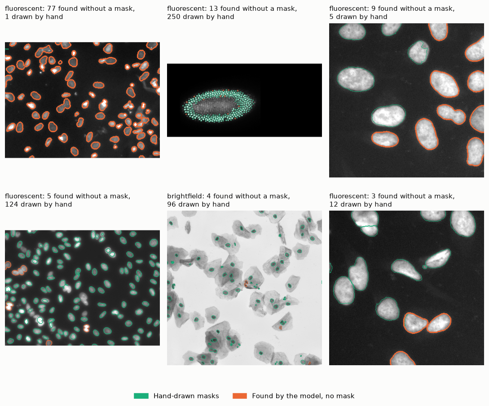

# Nuclei segmentation, end to end

A small image segmentation pipeline on public microscopy data, covering each step of a
real project: dataset preparation, annotation quality control, transfer learning, model
evaluation, optimization for a CPU server, and a web app plus API for online inference.



After training, the model gives a second opinion on the labels. In the top-left image,
one nucleus was labeled by hand and the model found 77 more.

## Files

| File | What it does |
|---|---|
| `nuclei_segmentation.ipynb` | The whole pipeline in 7 sections, with outputs |
| `build_nb.py` | Builds the notebook. Edit this file, then run it to regenerate the notebook |
| `inference.py` | Pre-processing, nucleus splitting and drawing, shared by the notebook, the app and the API |
| `serve.py` | REST API (FastAPI) around the ONNX model |
| `qc_flags.csv` | Masks flagged by the label checks before training |
| `review_list.csv` | Images where the trained model found nuclei that have no mask |
| `figures/` | The notebook's figures as images |
| `examples/` | One test image of each type |

## Results

| | Result |
|---|---|
| Test Dice, 100 test images | 0.920 (IoU 0.855) |
| By image type | fluorescent 0.927, stained tissue 0.894, brightfield 0.839 (2 test images only) |
| Pretrained vs random start, best validation Dice | 0.925 vs 0.911 |
| Nucleus count, median error | 10% (fluorescent 9%, stained tissue 22%) |
| Label checks before training | 45 masks in 22 images flagged for review, 425 small holes filled |
| Label check after training | 40 training and validation images with nuclei that have no mask (152 nuclei) |
| ONNX Runtime on a CPU, 512 x 512 image | about 2x faster than PyTorch, identical masks |
| 8-bit ONNX model | 4x smaller (25 MB), test Dice 0.917 |

Test images were used once, after the threshold was chosen on the validation images.

## Run it

```
python -m venv .venv
source .venv/bin/activate
pip install -r requirements.txt
```

Download `stage1_train.zip` from https://bbbc.broadinstitute.org/BBBC038 and unzip it
into `data/stage1_train/`. Then open `nuclei_segmentation.ipynb` and run all cells.

The trained models are not in this repository, so the first run trains both models,
which takes about 30 minutes on a laptop with an Apple M-series chip. After that the models are saved in
`models/`, and running all cells again takes a few minutes. Set `RETRAIN = True` to train
again.

REST API, once the notebook has written the ONNX model:

```
uvicorn serve:app --port 8000
curl -F "file=@examples/fluorescent.png" http://127.0.0.1:8000/segment
```

## Data

2018 Data Science Bowl, Broad Bioimage Benchmark Collection, BBBC038v1. Public domain
(CC0). Caicedo JC et al. Nucleus segmentation across imaging experiments: the 2018 Data
Science Bowl. *Nature Methods* 16, 1247-1253 (2019).
